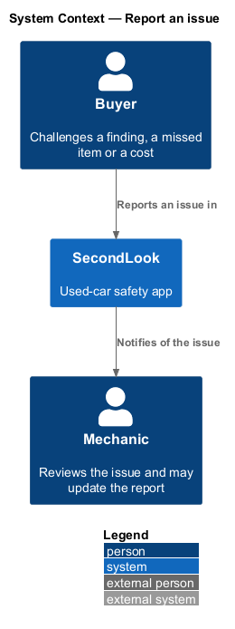
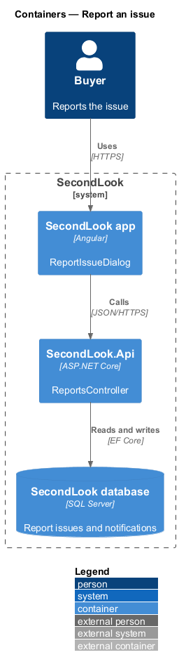
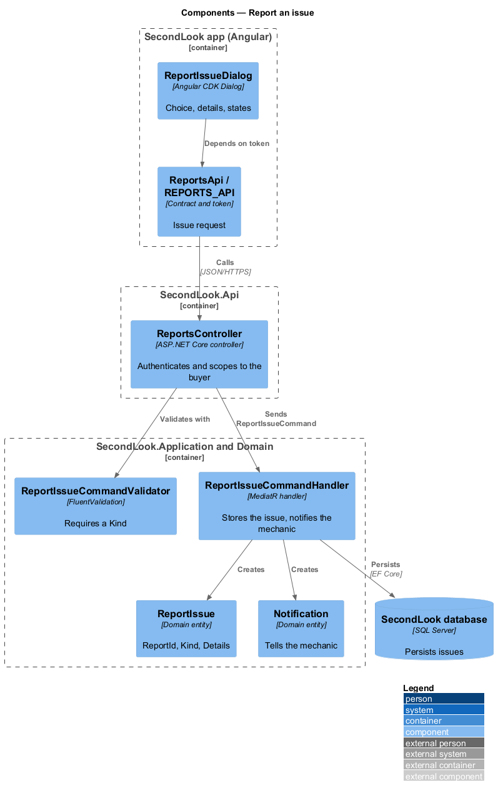
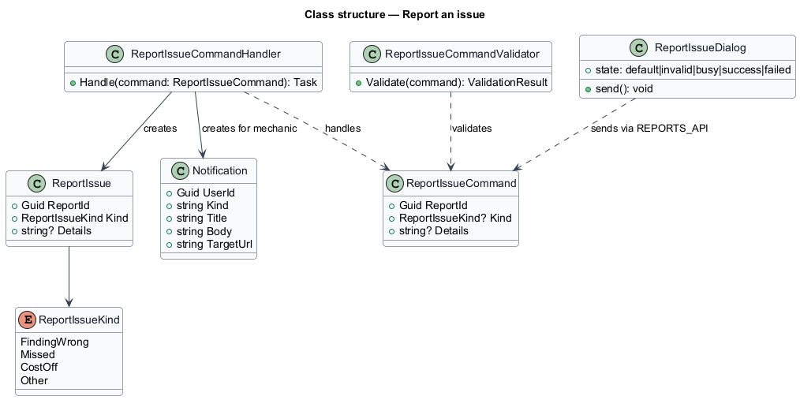
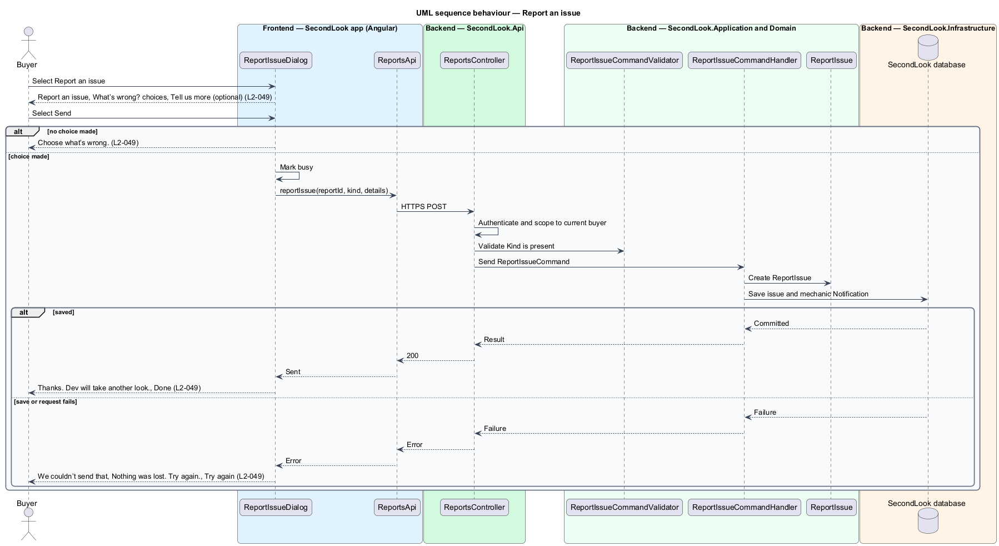

# Report an issue

## Overview

SecondLook is a used-car safety app for buyers purchasing a vehicle "as is" who cannot get a mechanic to the car in person. This feature lets the buyer challenge a report from the "Report an issue" button on `ReportPage`. The mechanic who wrote the report is told and reviews it.

A *report issue* is a buyer-submitted challenge to one report, classified as one of four kinds, with optional free text.

This document assumes no prior knowledge of SecondLook internals; the diagrams show where each part lives.

## Description

The feature is a vertical slice from the Angular app to the database. No issue code exists yet, so every component below is introduced by this design.

- **`ReportIssueDialog`** — Angular dialog in `projects/secondlook/src/app/dialogs/`, opened with Angular CDK Dialog from `ReportPage`. It holds the state `default`, `invalid`, `busy`, `success` and `failed`.
- **`ReportsApi` / `REPORTS_API`** — contract and injection token in `projects/api`. The dialog depends on the token.
- **`ReportsController`** — controller in `SecondLook.Api`, base route `/api/reports`. It authenticates the caller and scopes the report to the current buyer (`L2-057`). The endpoint path is `<TO SUPPLY>`.
- **`ReportIssueCommand`**, **`ReportIssueCommandValidator`**, **`ReportIssueCommandHandler`** — the command carries the report identifier, a `ReportIssueKind` and optional details. The validator rejects a missing kind. The handler creates a `ReportIssue` and a `Notification` for the mechanic who wrote the report, and saves both in one unit of work. The notification kind, title and body are `<TO SUPPLY>`.
- **`ReportIssue`** — domain entity (`ReportId`, `Kind`, `Details`). `Kind` takes `FindingWrong`, `Missed`, `CostOff` or `Other`, which map to the labels "A finding looks wrong", "Something was missed", "The cost seems off" and "Something else". The maximum length of the details text is `<TO SUPPLY>`.

State behaviour of the dialog:

- **Default.** The dialog shows "Report an issue", "Think the mechanic got something wrong? Tell us and they’ll review it.", the required choice "What’s wrong?" with the placeholder "Choose one", the four options, and the optional field "Tell us more (optional)", with "Cancel" and "Send".
- **Invalid.** When the buyer sends with no choice, the choice shows "Choose what’s wrong.".
- **Busy.** The dialog keeps the entered values and is marked busy while the request runs. The busy control states are `<TO SUPPLY>`.
- **Success.** The dialog shows "Thanks. Dev will take another look." with "He’ll reply within one business day. If something changes, we’ll update the report." and "Done". The name comes from the report author. The pronoun source, the enforcement of the reply time and the way the report is updated are `<TO SUPPLY>`.
- **Failed.** The dialog shows "We couldn’t send that" with "Nothing was lost. Try again." and "Try again". The entered values stay.

## Requirements

The feature realizes the following level-2 (L2) requirements. Each L2 requirement refines a level-1 (L1) requirement, cited by identifier.

| L2 ID | Refines (L1) | Requirement |
|-------|--------------|-------------|
| `L2-049` | `L1-010` | Report an issue. When the buyer selects "Report an issue", a dialog shall show "Report an issue", "Think the mechanic got something wrong? Tell us and they’ll review it.", a required "What’s wrong?" choice from "A finding looks wrong", "Something was missed", "The cost seems off" and "Something else", and an optional "Tell us more (optional)". When the buyer sends with no choice, the dialog shall show "Choose what’s wrong.". When the issue is sent with a choice, the dialog shall show "Thanks. Dev will take another look." with "He’ll reply within one business day. If something changes, we’ll update the report." and "Done". When the issue does not send, the dialog shall show "We couldn’t send that" with "Nothing was lost. Try again." and "Try again". |

## Diagrams

### System context

The buyer reports an issue in SecondLook. The system notifies the mechanic.

### Containers

The Angular app calls `SecondLook.Api`, which writes the issue and the notification to the database.

### Components

`ReportIssueCommandHandler` creates a `ReportIssue` and a `Notification` after `ReportIssueCommandValidator` accepts the command.

### Class structure

`ReportIssueCommand` carries a nullable `ReportIssueKind` so that the validator can reject a missing choice.

### Behaviour — report an issue

The dialog rejects a missing choice, then sends the issue. The flow alternates between the success and failed states.

