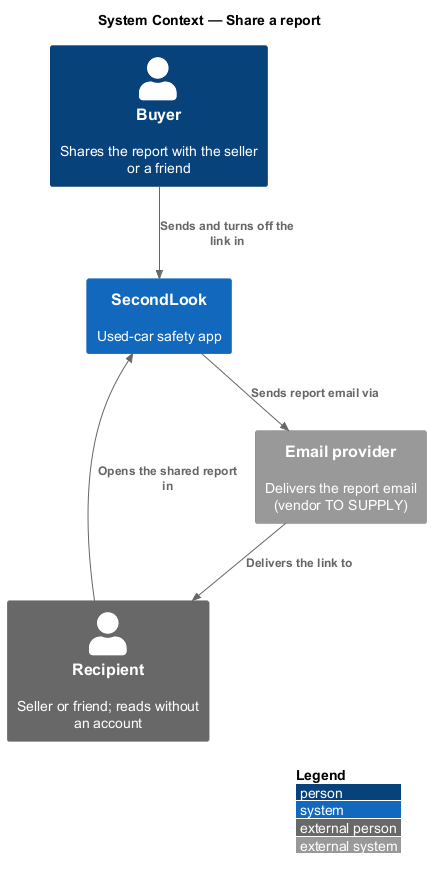
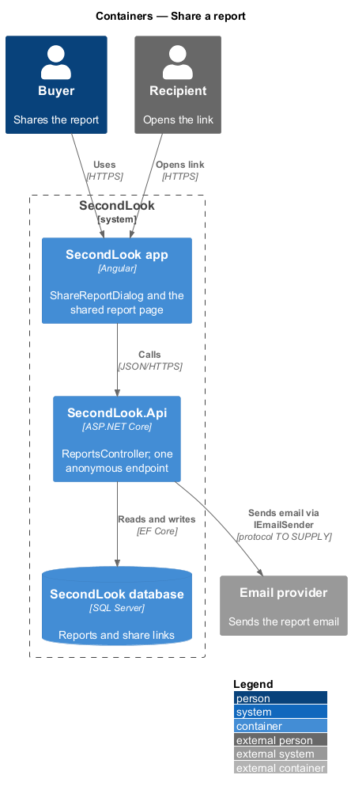
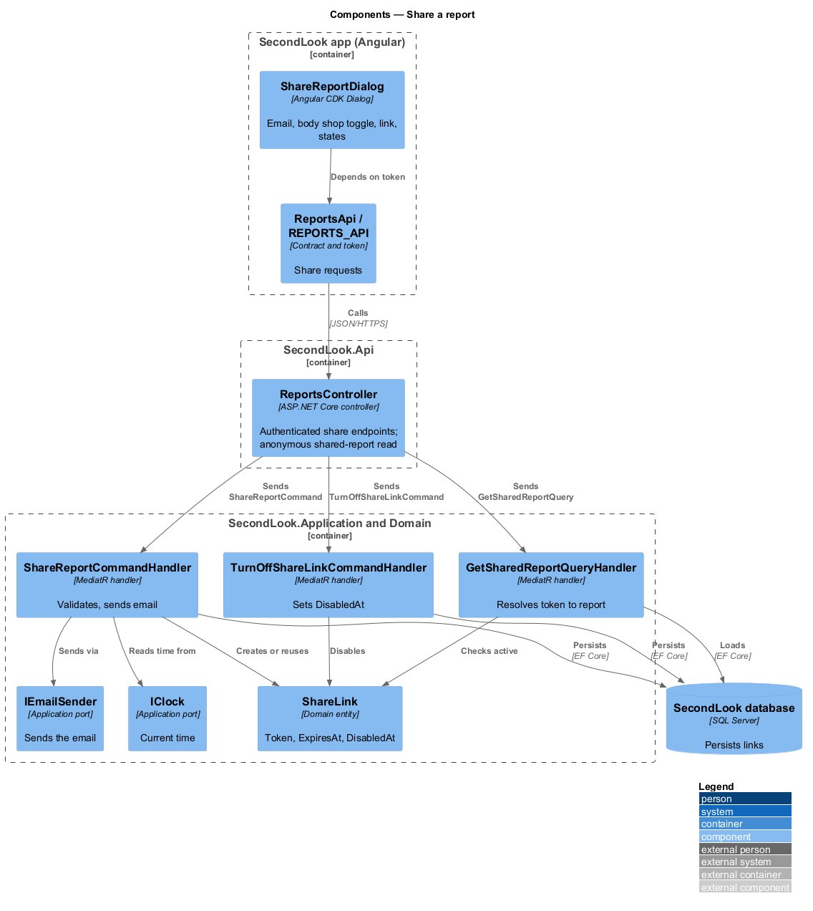
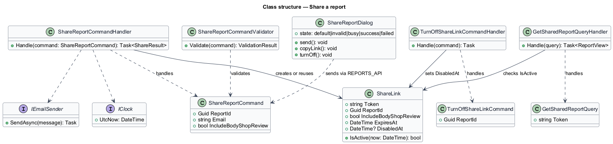
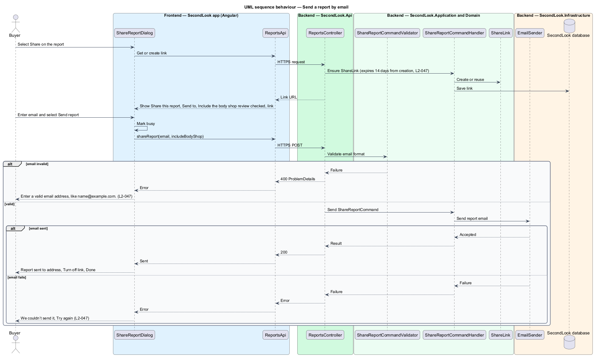
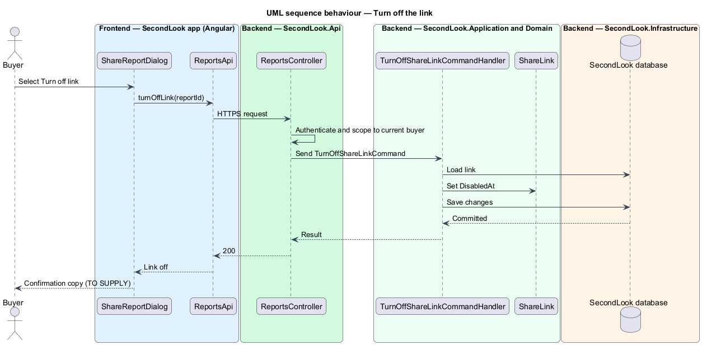
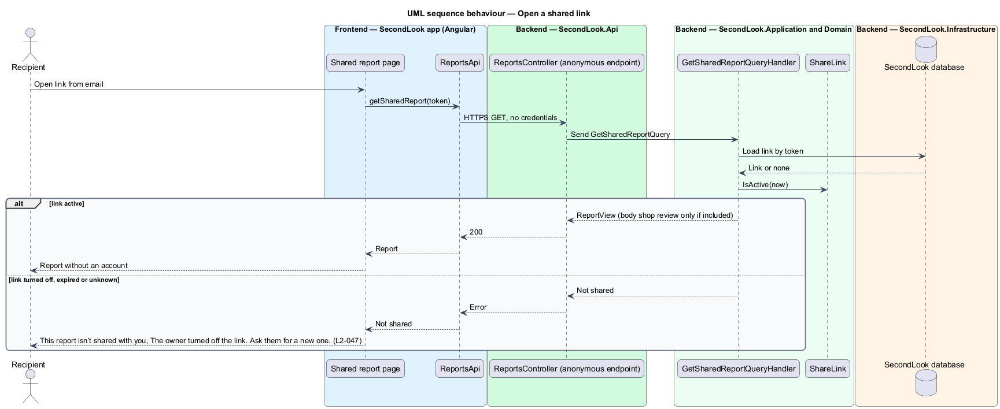

# Share a report

## Overview

SecondLook is a used-car safety app for buyers purchasing a vehicle "as is" who cannot get a mechanic to the car in person. This feature lets the buyer send the report to the seller or a friend from the report page, by email or by a copied link, and turn the link off later. The dialog opens from the "Share" button on `ReportPage`.

A *share link* is a revocable address that shows one report to a person without an account, valid for 14 days from creation. A *recipient* is the person who opens a share link. The mocks cover the dialog states `default`, `invalid`, `busy`, `success` and `failed`, and the page a recipient sees when the link is off.

This document assumes no prior knowledge of SecondLook internals; the diagrams show where each part lives.

## Description

The feature is a vertical slice from the Angular app to the database and an email sender. No sharing code exists yet, so every component below is introduced by this design.

- **`ShareReportDialog`** — Angular dialog in `projects/secondlook/src/app/dialogs/`, opened with Angular CDK Dialog from `ReportPage`. It holds the state `default`, `invalid`, `busy`, `success` and `failed`. It contains no inline form in a page.
- **`ReportsApi` / `REPORTS_API`** — contract and injection token in `projects/api`. The dialog depends on the token.
- **`ReportsController`** — controller in `SecondLook.Api`, base route `/api/reports`. The share endpoints are authenticated and scoped to the current buyer (`L2-057`). One endpoint, which reads a report by share token, is intentionally anonymous. Endpoint paths and the public route of the shared report page are `<TO SUPPLY>`.
- **`ShareReportCommand`**, **`ShareReportCommandValidator`**, **`ShareReportCommandHandler`** — the command carries the report identifier, the recipient email and the body shop flag. The validator rejects an invalid email. The handler ensures a `ShareLink` exists, sends the email through `IEmailSender`, and returns the result.
- **`TurnOffShareLinkCommand`** and handler — set `ShareLink.DisabledAt`.
- **`GetSharedReportQuery`** and handler — resolve a token to a report for a recipient with no account. The handler includes the body shop review only when the link was created with the flag set.
- **`ShareLink`** — domain entity (`Token`, `ExpiresAt`, `DisabledAt`). `ExpiresAt` is 14 days after creation, computed from `IClock`. A link is active when it is not disabled and has not expired. The token format and length are `<TO SUPPLY>`.
- **`IEmailSender`** — application port. The vendor and the email template are `<TO SUPPLY>`.

State behaviour of the dialog:

- **Default.** The dialog shows "Share this report", "Send it to the seller or a friend who knows cars.", the field "Send to", the checkbox "Include the body shop review" checked with the hint "Mira’s findings travel with the report.", a link with a "Copy" button and "Works for 14 days. Turn it off any time.", and the buttons "Cancel" and "Send report".
- **Invalid.** When the email is not valid, the field shows "Enter a valid email address, like name@example.com.". The check runs in the dialog and again in `ShareReportCommandValidator`.
- **Busy.** While the request runs, the dialog is marked busy. The busy copy and the control states are `<TO SUPPLY>`; the mock shows the default layout.
- **Success.** The dialog shows "Report sent to sam.whitaker@example.com" with "He can read it without an account. You can turn the link off from this dialog." and the buttons "Turn off link" and "Done". The source of the pronoun in the copy is `<TO SUPPLY>`.
- **Failed.** The dialog shows "We couldn’t send it" with "The email didn’t go out. Copy the link instead, or try again." and "Try again". The form stays visible.
- **Link off.** When a recipient opens a link that has been turned off, the page shows "This report isn’t shared with you" with "The owner turned off the link. Ask them for a new one." and, in the mock, the action "Back to your inspections". The copy shown for an expired link is `<TO SUPPLY>`.

The link is created when the dialog opens, so that the link is available to copy before the email is sent. The idempotency rule in AGENTS.md applies to bookings and payments; sharing is not covered by it. Whether re-sending to the same address creates a second email is `<TO SUPPLY>`.

## Requirements

The feature realizes the following level-2 (L2) requirements. Each L2 requirement refines a level-1 (L1) requirement, cited by identifier.

| L2 ID | Refines (L1) | Requirement |
|-------|--------------|-------------|
| `L2-047` | `L1-010` | Share a report. When the buyer selects "Share", a dialog shall show "Share this report", "Send it to the seller or a friend who knows cars.", "Send to", "Include the body shop review" checked, a link to copy with "Works for 14 days. Turn it off any time.", and "Send report". When the buyer sends with an email of "sam.whitaker@example", the field shall show "Enter a valid email address, like name@example.com.". When the report is sent to a valid email, the dialog shall show "Report sent to sam.whitaker@example.com" with "He can read it without an account. You can turn the link off from this dialog." and the buttons "Turn off link" and "Done". When the email does not go out, the dialog shall show "We couldn’t send it" with "The email didn’t go out. Copy the link instead, or try again." and "Try again". When the buyer has turned the link off and someone opens it, they shall see "This report isn’t shared with you" with "The owner turned off the link. Ask them for a new one.". |

## Diagrams

### System context

The buyer shares a report through SecondLook. An email provider delivers the link, and the recipient opens it without an account.

### Containers

The Angular app calls `SecondLook.Api`, which stores share links in the database and sends email. One API endpoint accepts anonymous requests.

### Components

`ShareReportDialog` calls `ReportsController`, which dispatches three requests. `ShareLink` holds the expiry and the off switch, and `IClock` supplies the time.

### Class structure

`ShareReportCommandHandler` creates or reuses a `ShareLink` and sends the email. `GetSharedReportQueryHandler` checks `ShareLink.IsActive`.

### Behaviour — send a report by email

The dialog gets the link, then sends the email. The flow alternates between an invalid email, a sent report and a failed send.

### Behaviour — turn off the link

The handler sets `DisabledAt` so that the link stops working at once.

### Behaviour — open a shared link

The anonymous endpoint returns the report for an active link, or the not-shared result for a link that is off, expired or unknown.

