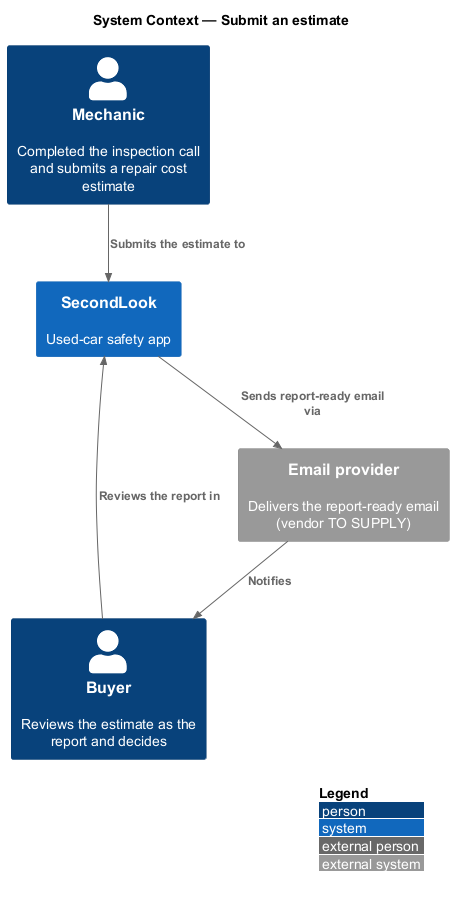
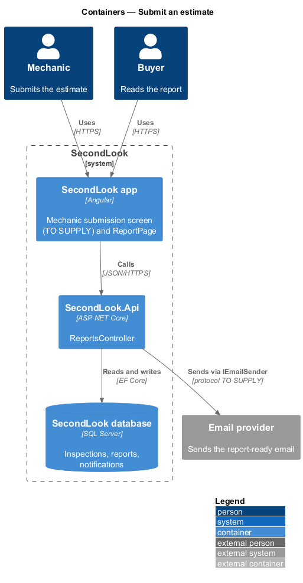
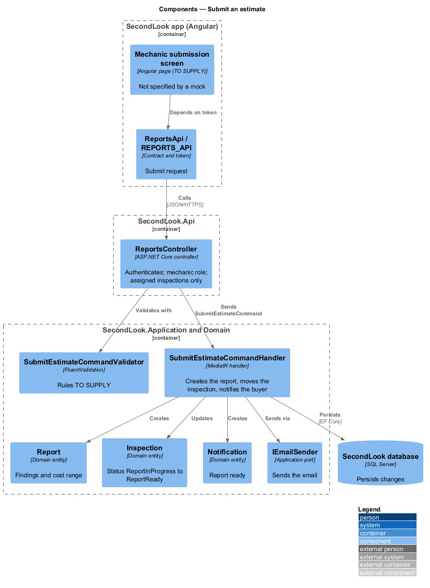
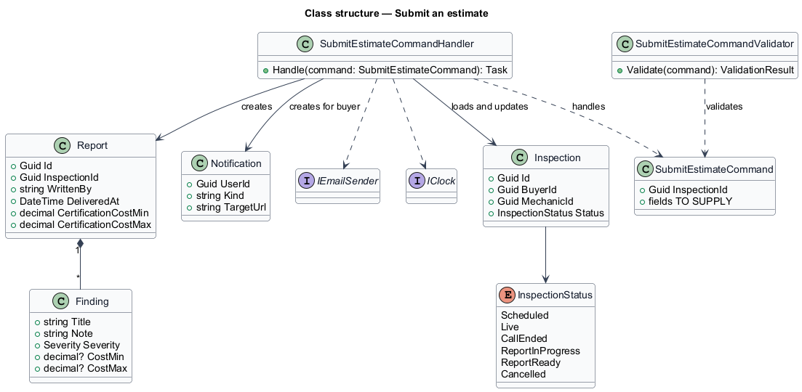
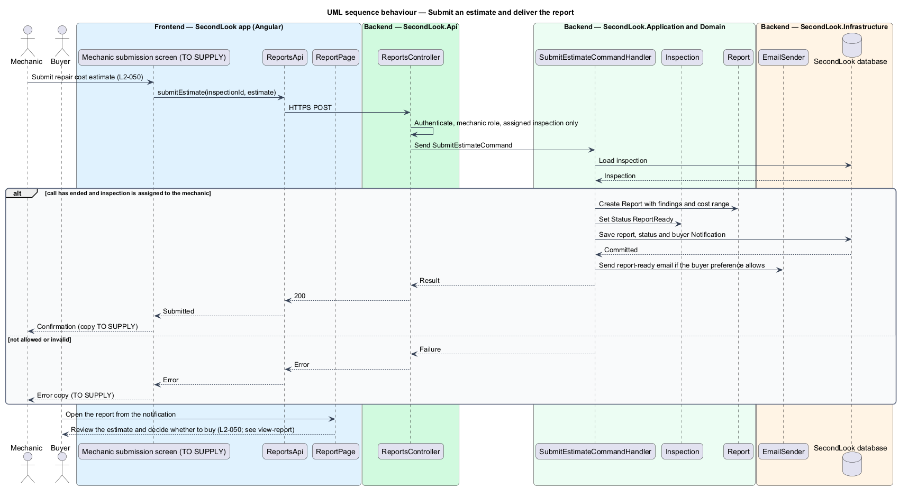

# Submit an estimate

## Overview

SecondLook is a used-car safety app for buyers purchasing a vehicle "as is" who cannot get a mechanic to the car in person. This feature covers the mechanic side of the journey "Receive safety certification estimate": the mechanic submits a repair cost estimate after the inspection call, and the buyer reviews it as the report and decides whether to buy.

This feature is sourced from the user journey only. No mock exists for the mechanic-side submission, and `docs/user-journeys.md` states the journey in one line: "Mechanic submits a repair cost estimate; buyer reviews it and decides." This design therefore keeps to the L2 text and the shared domain model, and marks every other detail `<TO SUPPLY>`. The buyer-facing screen is specified in the view-report design.

An *estimate* is the mechanic’s repair cost figure for getting the vehicle safety certified. In the domain model, the submitted estimate becomes a `Report`.

This document assumes no prior knowledge of SecondLook internals; the diagrams show where each part lives.

## Description

The feature is a vertical slice from a mechanic screen to the database and the buyer notification. No estimate code exists yet, so every component below is introduced by this design.

- **Mechanic submission screen** — Angular page in `projects/secondlook/src/app/pages/`. Its name, route, fields and layout are `<TO SUPPLY>`. No mock covers it, and this design adds no fields.
- **`ReportsApi` / `REPORTS_API`** — contract and injection token in `projects/api`. The screen depends on the token.
- **`ReportsController`** — controller in `SecondLook.Api`, base route `/api/reports`. It authenticates the caller, requires the `Mechanic` role, and allows a mechanic to submit only for inspections assigned to the mechanic. The endpoint path is `<TO SUPPLY>`.
- **`SubmitEstimateCommand`**, **`SubmitEstimateCommandValidator`**, **`SubmitEstimateCommandHandler`** — the command carries the inspection identifier and the estimate content. The content fields, and the validation rules, are `<TO SUPPLY>`. The shape of the stored result is known from the report: a `Report` with `Finding` items (title, note, severity, optional cost range) and a certification cost range. Whether the mechanic enters the findings and the range directly, or the range is derived from the findings, is `<TO SUPPLY>`.
- **`Inspection`** — domain entity. After a call ends, the status moves toward `ReportInProgress`. On submission the handler sets `ReportReady`. The permitted transitions and any resubmission or amendment rule are `<TO SUPPLY>`.
- **`Notification`** and **`IEmailSender`** — the handler creates a notification for the buyer that the report is ready, with the target `ReportPage`. The handler sends an email only when the buyer’s `NotificationPreference.EmailWhenReportReady` allows it. The notification title and body, and the email template, are `<TO SUPPLY>`.

Review by the buyer: when the estimate is submitted, the buyer opens it as the report (`L2-045`, specified in the view-report design). The report shows the cost range and the all-in total, which supports the decision on whether to buy. The decision itself stays with the buyer, and the system records no decision.

The failure behaviour on the mechanic side, including the copy shown when a submission is rejected, is `<TO SUPPLY>`.

## Requirements

The feature realizes the following level-2 (L2) requirement. The L2 requirement refines a level-1 (L1) requirement, cited by identifier. The source is the journey, and no UI copy is quoted.

| L2 ID | Refines (L1) | Requirement |
|-------|--------------|-------------|
| `L2-050` | `L1-010` | Mechanic submits an estimate. When a mechanic has completed an inspection and submits a repair cost estimate, the buyer shall be able to review it as the report. When the estimate is submitted and the buyer opens it, the buyer shall be able to decide whether to buy the vehicle. |

## Diagrams

### System context

The mechanic submits the estimate to SecondLook. The buyer is notified and reviews it as the report.

### Containers

The Angular app calls `SecondLook.Api`, which writes the report, the inspection status and the notification to the database.

### Components

`SubmitEstimateCommandHandler` creates the `Report`, updates the `Inspection` and creates the `Notification`. The mechanic screen is shown as `<TO SUPPLY>`.

### Class structure

The handler creates a `Report` that owns `Finding` items, moves the `Inspection` to `ReportReady`, and creates a `Notification`.

### Behaviour — submit an estimate

The mechanic submits, the handler delivers the report and notifies the buyer, and the buyer opens it on `ReportPage`.

