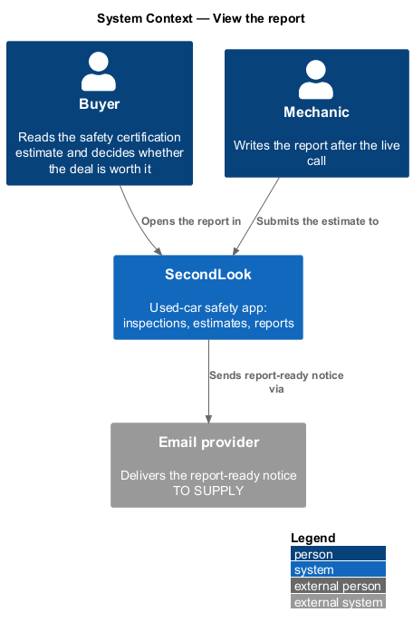
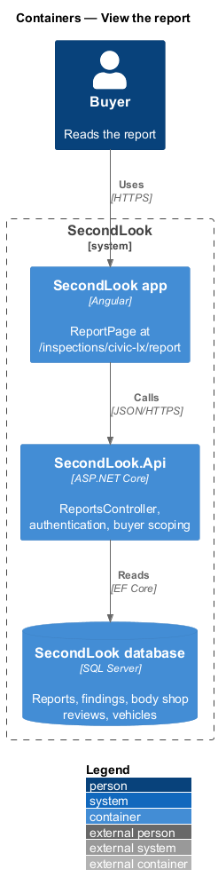
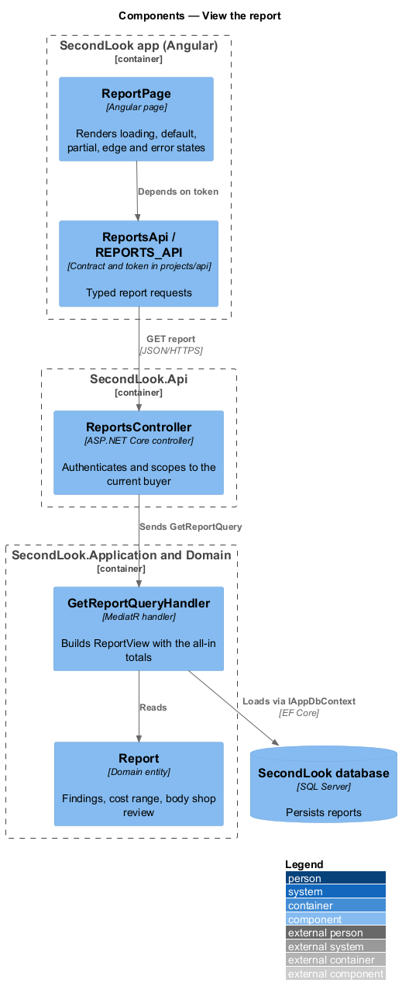
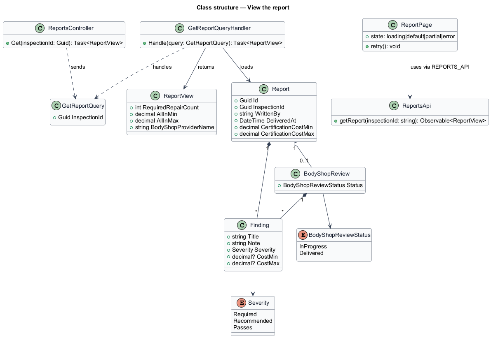
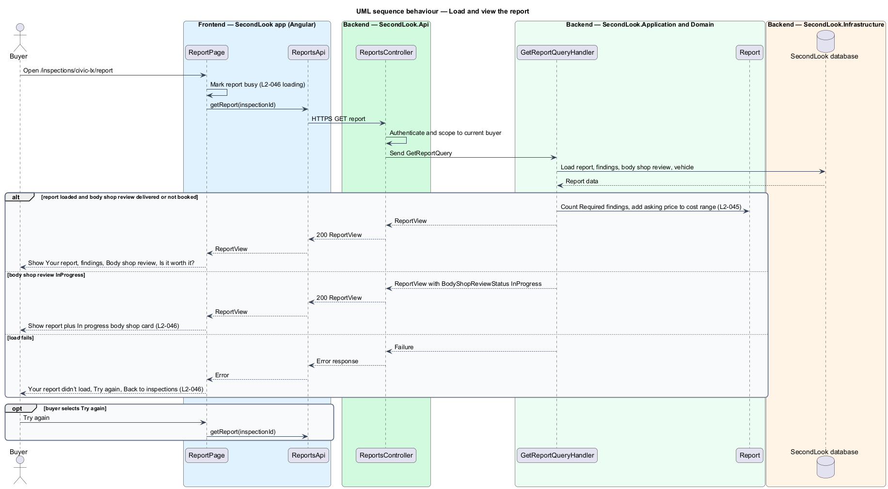

# View the report

## Overview

SecondLook is a used-car safety app for buyers purchasing a vehicle "as is" who cannot get a mechanic to the car in person. After the live call, the mechanic writes a report. This feature covers the buyer-facing report page at the route `/inspections/civic-lx/report`, where the buyer reads the safety certification estimate and decides whether the deal is worth it.

A *report* is the written result of one inspection, delivered by the mechanic, holding findings and a certification cost range. A *finding* is one inspected item with a title, a note, a severity and an optional cost range. *All-in cost* is the asking price plus the certification cost range. The *body shop review* is an optional second set of findings from a body shop, shown as its own card.

This document assumes no prior knowledge of SecondLook internals; the diagrams show where each part lives.

## Description

The feature is a read-only vertical slice from the Angular app to the database. No report code exists yet, so every component below is introduced by this design.

- **`ReportPage`** — Angular page in `projects/secondlook/src/app/pages/`, routed at `/inspections/civic-lx/report` (the mock route; the production route parameter is `<TO SUPPLY>`). It holds the view state `loading`, `default`, `partial`, `edge` and `error`. The page is reached from `InspectionDetailPage`.
- **`ReportsApi` / `REPORTS_API`** — contract and injection token in `projects/api`. The page depends on the token, not on the concrete client.
- **`ReportsController`** — ASP.NET Core controller in `SecondLook.Api`, base route `/api/reports`. It authenticates the caller, scopes the report to the current buyer (`L2-057`), and sends `GetReportQuery`. The endpoint path under the base is `<TO SUPPLY>`.
- **`GetReportQuery`** and **`GetReportQueryHandler`** — MediatR query and handler in `SecondLook.Application`. The handler loads the `Report`, its `Finding` items, the optional `BodyShopReview`, and the `Vehicle`. It returns a `ReportView` that carries the count of `Required` findings and the all-in range (`Vehicle.AskingPrice` plus `CertificationCostMin` and `CertificationCostMax`). Business rules stay in the handler, not in the controller.
- **`Report`**, **`Finding`**, **`BodyShopReview`** — domain entities. `Severity` takes `Required`, `Recommended` or `Passes`. `BodyShopReview.Status` takes `InProgress` or `Delivered`.

State behaviour on the page:

- **Default.** The page shows the heading "Your report" and the subtitle "Call finished Thu 29 Oct 2026 · written by Dev Patel". The report header shows the vehicle, the odometer, the VIN and the mechanic with certification number and city. The summary shows "Estimated cost to get it safety certified", the cost range, the count of required repairs and the all-in range. The summary also holds the "Download report" button, owned by the download-report design. The header actions "Share" and "Report an issue" open the share-report and report-issue dialogs.
- **Findings.** Each finding shows its title, note, status label and cost range. A finding with no cost shows a dash. The status is shown as text (`Required`, `Recommended`, `Passes`) in addition to colour, so it is readable without colour.
- **Body shop review.** When the report has a delivered body shop review, the "Body shop review" card lists its findings with the provider name and city, followed by the note "Body repairs are separate from the safety certification estimate above.". Body shop costs are excluded from the all-in range.
- **Is it worth it?** The card shows the asking price plus the cost range as the all-in total, with the links "Compare with another car" (to `ComparePage`) and "Add another car · $25" (opens `AddAnotherCarDialog`).
- **Loading.** The report container carries `aria-busy="true"` while the request runs.
- **Partial.** When the body shop review has status `InProgress`, the body shop card shows "In progress", "Mira is finishing the body review" and "It’s usually ready 30 minutes after the mechanic’s. We’ll notify you.". The rest of the report renders. The provider name in the title comes from the body shop `Provider.DisplayName`. The notification raised when the body shop review is delivered is `<TO SUPPLY>`.
- **Edge.** A finding with a long title and note wraps inside its row, and the status and cost columns stay visible. The page does not truncate the title.
- **Error.** When the request fails, the page shows "Your report didn’t load" with "It’s safe in your account. Try again, or download a copy once it opens." and the buttons "Try again" and "Back to inspections". "Try again" repeats the request. "Back to inspections" navigates to `DashboardPage`.
- **Forbidden.** The mock shows "This report isn’t shared with you" with "The owner turned off the link. Ask them for a new one." and "Back to your inspections". The condition and the copy belong to the shared link (`L2-047`) and are specified in the share-report design. For a signed-in buyer requesting another buyer’s report, the response status (403 or 404) is `<TO SUPPLY>`; the API shall not expose the report.

The empty state does not apply. A report exists only after the call has happened.

## Requirements

The feature realizes the following level-2 (L2) requirements. Each L2 requirement refines a level-1 (L1) requirement, cited by identifier.

| L2 ID | Refines (L1) | Requirement |
|-------|--------------|-------------|
| `L2-045` | `L1-010` | Report content. When the buyer opens a delivered report, it shall show "Your report", "Call finished Thu 29 Oct 2026 · written by Dev Patel", the vehicle, odometer, VIN and mechanic, and "Estimated cost to get it safety certified" with the cost range. When the summary shows required repairs, it shall show how many repairs are required and the asking price plus the cost range as the all-in total. The findings list shall show for each finding its title, note, status (Required, Recommended or Passes) and cost range, with a dash for no cost, and the status shall be readable without colour. When the report has a body shop review, "Body shop review" shall list its findings and the note "Body repairs are separate from the safety certification estimate above.". "Is it worth it?" shall show asking price plus certification cost as the all-in total, with "Compare with another car" and "Add another car · $25". |
| `L2-046` | `L1-010` | Report loading, partial and error states. While the report is loading, it shall be marked busy. When the body shop review is not ready, the body shop card shall show "In progress", "Mira is finishing the body review" and "It’s usually ready 30 minutes after the mechanic’s. We’ll notify you.", and the rest of the report shall show. When the report fails to load, the page shall show "Your report didn’t load" with "It’s safe in your account. Try again, or download a copy once it opens." and the buttons "Try again" and "Back to inspections". When a finding has a very long title, the page shall remain readable. |

## Diagrams

### System context

The buyer reads the report in SecondLook. The mechanic submits the estimate that becomes the report, and an email provider carries the report-ready notice.

### Containers

The Angular app calls `SecondLook.Api`, which reads reports from the SecondLook database. The feature is read-only.

### Components

`ReportPage` reaches `ReportsController` through the `REPORTS_API` token. `GetReportQueryHandler` loads the `Report` and builds the view.

### Class structure

`Report` owns its `Finding` items and optionally references a `BodyShopReview`. `GetReportQueryHandler` returns a `ReportView` with the required-repair count and the all-in range.

### Behaviour — load and view the report

The page marks the report busy, requests the report, and renders the default, partial or error state. "Try again" repeats the request.

## Implementation notes (J11)

Delivered as `ReportPage` at `/inspections/:id/report` and the shared `ReportView` (L2-045, L2-046, L2-077). The buyer reaches it from "View report" on the inspection. States: loading (busy), not ready (an info alert; the server answers 409), not found for anyone else (404), failed with "Try again", and the report with totals, findings and the not-a-certificate statement. A body shop assigned to the inspection shows "In progress" until J12 delivers its findings. Not on the page yet: "Compare with another car" (J13) and "Add another car · $25"; the "We’ll notify you" line is left out until notifications exist (J14).
